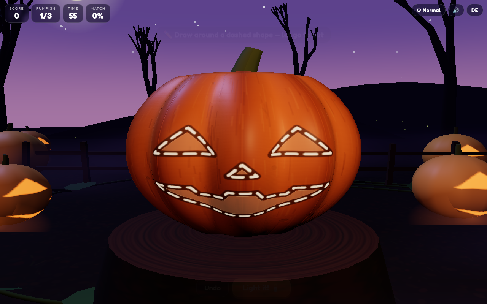
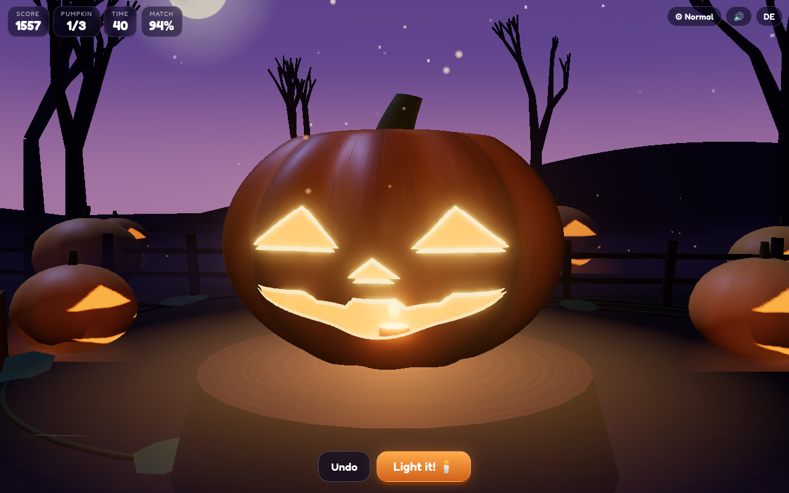

# 🎃 Pumpkin Carver

A cozy-spooky 3D Halloween browser game. A big ribbed pumpkin sits on a tree stump in a moonlit pumpkin patch. Draw around the shapes with your mouse or finger, right on the curved surface: the knife follows, the piece pops out with a wet crunch, seeds fly. Then strike the match — the candle lights up, the face glows and the pumpkin spins for its showcase.

**Play:** [online version (GitHub Pages)](https://frank-otto.github.io/pumpkin-carver/)

## How to play
- **Draw a closed loop** around a dashed shape on the pumpkin and let go — the piece is cut out and pops away.
- **Match the target face** before the time runs out. The cleaner the cut, the higher the match (accuracy) and the more stars. The timer only starts with your first cut.
- All shapes cut → the candle lights by itself. Or press **Light it!** whenever you like. **Undo** puts the last piece back.
- Three pumpkins per round, each with a different face. Score = accuracy + time bonus (+ a perfect bonus at 90 %+).

Difficulty: **Easy** (75 s, thick guides, rough cuts snap onto the shape), **Medium** (55 s) and **Hard** (42 s, finer faces, ×1.5 points). Remembered, each with its own highscore.

**Kids mode:** big simple shapes, no timer, generous magic snap — every pumpkin glows in the end.

**Free carving:** no template, no timer — carve your own face, light it and save a card.

Extras: the language follows your phone or browser (German devices get German, everything else English), with a small **DE/EN** toggle (remembered), shareable **pumpkin card** (PNG, 1080×1350) of your carved jack-o'-lantern, **quality levels** (Low / Normal / High / Ultra; steps down automatically if the frame rate drops), a glowing demo pumpkin in the menu.

## Tech
Three.js (WebGL): a parametric ribbed pumpkin whose shader reads a carving mask (cut-outs, glowing flesh rim, knife grooves, dashed guides), an inner flesh shell, real 3D chunks built from your cut shape, a candle point light with flicker, moonlight shadows, fog, fireflies, ACES tone mapping and a restrained bloom (no glare). Accuracy is measured as intersection-over-union between your cuts and the target face. Bundled with esbuild into one classic script, so it runs straight from `file://`. All sounds are real recorded CC0 samples embedded in the page.

## Run locally
Open `index.html` directly (on a Mac you can also double-click `start.command`). To rebuild after editing `src/`:
```
npm install && npm run build
```

## Tests
`python3 test/test_game.py` (Playwright + Chrome, headless WebGL, served over a local web server, 43 checks): real mouse and touch carving, accuracy, magic snap, undo, auto light and reveal, timer and time-up, highscore per difficulty, PNG card, EN/DE memory, kids and free mode, mobile layout, quality labels, glare and camera checks, no console errors, no synth sounds.
`python3 test/test_mobile.py`: 8 phone configurations (iPhone 13 / 8 / SE in WebKit, Pixel 7 in Chromium, portrait and landscape). It checks that every button is tappable and at least 44 px, that nothing is cut off or scrolls, the auto language, one tap to play with sound, touch control and flat memory.

## Credits
All sounds are recorded CC0 samples (see `LICENSES/SOUNDS.md`). Three.js (MIT). Font: Fredoka (SIL Open Font License 1.1).



